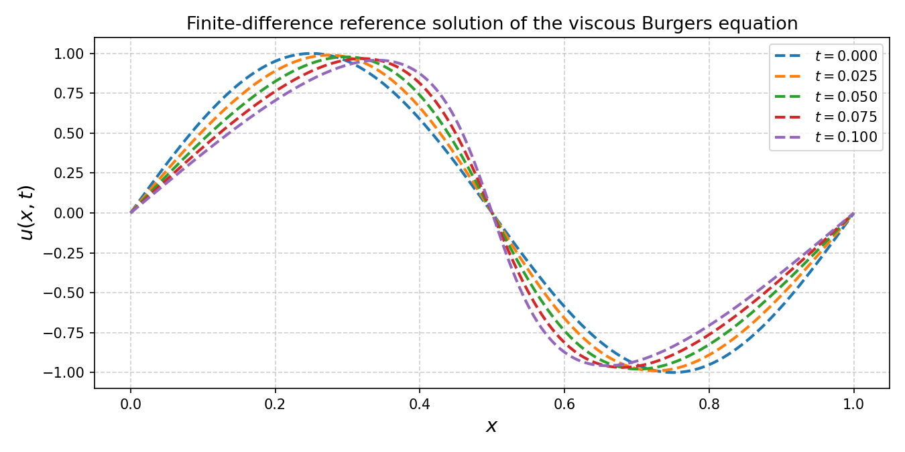

# Burgers 1D: PINN clássica vs. HPINN quântica de portas fixas

Código de suporte ao artigo. Resolve a equação de Burgers viscosa 1D periódica

```
u_t + u u_x = nu u_xx,   x em [0, L), t em [0, Tfin]
```

com três abordagens comparáveis: solução numérica de referência (diferenças
finitas), uma PINN clássica, e uma HPINN híbrida clássico-quântica com um
circuito Qiskit de portas fixas (sem parâmetros treináveis no circuito).

## Estrutura do repositório

```
.
├── README.md
├── requirements.txt
├── src/
│   ├── functions.py     # física (solver de referência), amostragem, loss, treino, plots
│   └── models.py        # ClassicalPINN e QuantumPINN (as duas únicas classes do projeto)
├── run_numerical.py     # só a solução numérica de referência, sem rede neural
├── run_classical.py     # treina apenas a PINN clássica
├── run_quantum.py       # treina apenas a HPINN quântica (Qiskit)
└── run_compare.py       # treina as duas e compara lado a lado
```

Tudo que é comum às duas redes (solver de diferenças finitas, amostragem de
pontos de colocação, resíduo físico, laço de treino, métricas, plots) está em
`src/functions.py`. Tudo que é específico de cada rede está em `src/models.py`,
em uma classe por caso (`ClassicalPINN`, `QuantumPINN`). Os scripts `run_*.py`
ficam fora de `src/` e são o ponto de entrada: cada um é executado sozinho,
sem precisar importar os outros.

## Instalação

```bash
pip install -r requirements.txt
```

`run_numerical.py` e `run_classical.py` só precisam de `numpy`, `torch` e
`matplotlib`. `run_quantum.py` e `run_compare.py` também precisam de
`qiskit`, `qiskit-machine-learning` e `qiskit-algorithms`.

## Como rodar

Cada script é autocontido: basta chamá-lo diretamente.

```bash
python run_numerical.py   # só a referência numérica (FDM), sem rede nenhuma
python run_classical.py   # PINN clássica
python run_quantum.py     # HPINN quântica (portas fixas)
python run_compare.py     # treina as duas e compara
```

Cada script salva as figuras geradas como `.png` no diretório atual e
imprime o erro relativo L2 final contra a referência numérica.

### Exemplo mínimo

`run_numerical.py` é o exemplo mais simples: resolve a equação por
diferenças finitas explícitas (sem nenhuma rede) e plota `u(x,t)` em cinco
instantes de tempo.

```bash
python run_numerical.py
# -> numerical_solution.png
```



### PINN clássica

```bash
python run_classical.py
# -> classical_loss.png, classical_solution.png
```

Treina `ClassicalPINN` (uma MLP simples) minimizando o resíduo da EDP em
pontos de colocação, com condição inicial e periodicidade impostas
exatamente na arquitetura (`u_theta(x,0) = u0(x)` por construção). Ao final,
compara a solução aprendida com a referência FDM em `t = Tfin` e imprime o
erro relativo L2.

### HPINN quântica

```bash
python run_quantum.py
# -> quantum_circuit.png, quantum_loss.png, quantum_solution.png
```

Treina `QuantumPINN`: uma rede clássica pré-processa as features periódicas
em ângulos de rotação, um circuito Qiskit fixo (sem pesos treináveis, apenas
portas de emaranhamento fixas como `cz_ring`, `linear_cnot`, etc. — veja
`FIXED_LAYERS` em `src/models.py`) produz valores esperados de Pauli-Z, e uma
segunda rede clássica pós-processa esses valores na correção escalar da
solução. Só as camadas clássicas são treinadas.

### Comparação

```bash
python run_compare.py
# -> compare_solution.png, compare_loss.png
```

Treina os dois modelos com a mesma semente e os mesmos hiperparâmetros de
treino/colocação, e plota a solução final e as curvas de perda das duas
lado a lado, além de imprimir a tabela de erro relativo L2 final.

## Ajustando o experimento

Cada `run_*.py` tem os parâmetros físicos e de treino declarados no topo do
próprio arquivo (`L`, `Tfin`, `nu`, número de épocas, arquitetura, etc.) —
não há um arquivo de configuração central. Isso mantém cada script legível e
executável sozinho; edite as constantes no topo do arquivo correspondente
para mudar o experimento. `EPOCHS = 400` nos scripts de treino é suficiente
para reproduzir os resultados do artigo; reduza para um teste rápido.
